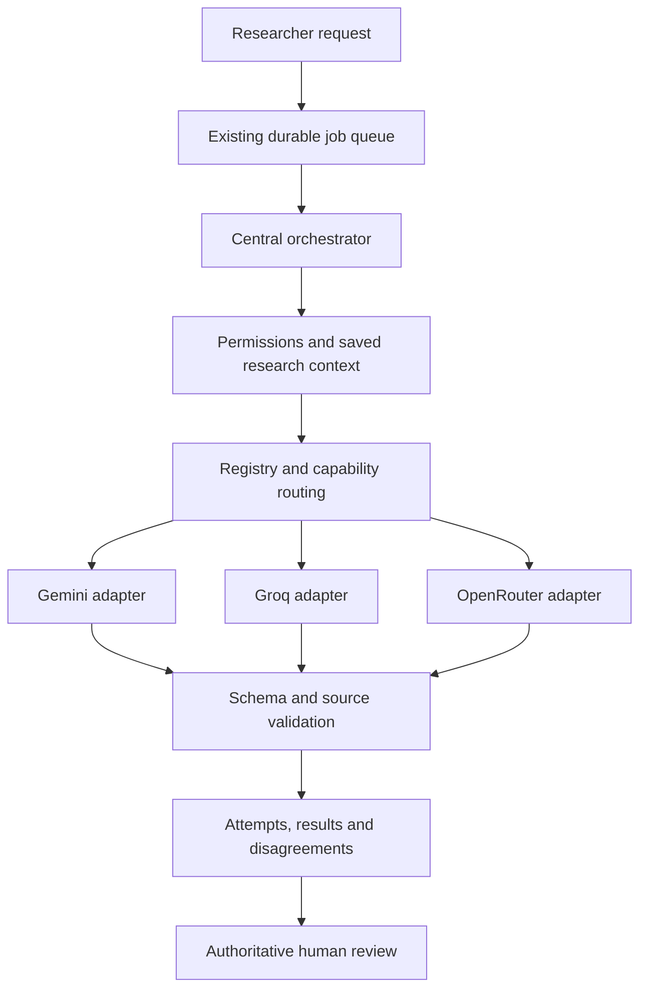

# Multi-model intelligence

Implemented configuration and runtime policy, verified against official documentation on **2026-11-11**. [ADR-034](DECISIONS.md#adr-034--controlled-multi-model-intelligence) amends ADR-033. The application remains a modular monolith with one orchestrator and the existing worker.

## Runtime



`AIProvider` is the existing common interface. Adapters translate HTTP requests, schema conventions, refusals and usage. Business services do not import provider SDKs. New adapters use native `fetch`; no additional SDK dependency is needed. Anthropic remains an explicit legacy option. Groq retains its strict JSON Schema, Harmony token estimate, free defaults and staged source checks.

The dated model registry holds capabilities, supported tasks, windows, output limits, structured-output mode, availability, timeouts and prices. Routing reads centralized task and role preferences, excludes unavailable/unverified models, checks capabilities and budgets, and applies privacy and spending policies. Model IDs can be changed through configuration; an unknown override stays `UNVERIFIED` until its metadata is supplied. Window size alone does not qualify a model for independent review.

| Default registry key | Provider / exact model ID | Context / maximum output | API and availability |
| --- | --- | --- | --- |
| `research` | Gemini / `gemini-3.8-flash` | 1,048,576 input / 65,536 output | Stateless Interactions API; JSON Schema; free service exists, confidential configuration uses paid service |
| `summary` | Groq / `openai/gpt-oss-20b` | 131,072 context / 65,536 output | OpenAI-compatible chat; strict JSON Schema; published free limits apply per model |
| `groq-research` | Groq / `openai/gpt-oss-120b` | 131,072 context / 65,536 output | Existing free reasoning route and compatible fallback |
| `review` | OpenRouter / `nvidia/nemotron-3.5-super-vl` | Conservative 262,144 / 65,536 | Paid route; endpoint-dependent schema/window support; free variant is unsuitable for confidential defaults |
| `secondary` | OpenRouter / `qwen/qwen3.8-27b` | Conservative 262,144 / 65,536 | Paid route; no free variant observed in the verified catalog |

OpenRouter aggregate catalog metadata is not a guarantee for a specific host. Before enabling a host, verify its model ID, context/output limits, `json_schema` support, retention contract and price. Configure lower verified limits when necessary. Requests require approved `only` hosts, `allow_fallbacks:false`, `require_parameters:true`, `data_collection:deny`, ZDR and price ceilings. A host that cannot meet the contract fails explicitly. Do not choose a free endpoint by adding `:free` to a model ID.

Official sources: [Gemini models](https://ai.google.dev/gemini-api/docs/models), [Interactions](https://ai.google.dev/gemini-api/docs/interactions), [Gemini pricing](https://ai.google.dev/gemini-api/docs/pricing), [Groq models](https://console.groq.com/docs/models), [Groq rate limits](https://console.groq.com/docs/rate-limits), [Groq structured output](https://console.groq.com/docs/structured-outputs), [OpenRouter model catalog](https://openrouter.ai/api/v1/models), [Nemotron endpoints](https://openrouter.ai/api/v1/models/nvidia/nemotron-3.5-super-vl/endpoints), [Qwen endpoints](https://openrouter.ai/api/v1/models/qwen/qwen3.8-27b/endpoints), [OpenRouter structured output](https://openrouter.ai/docs/guides/features/structured-outputs), [provider routing](https://openrouter.ai/docs/guides/routing/provider-selection).

## Configuration and privacy

`.env.example` lists every key. Defaults keep `AI_ROUTING_MODE=LEGACY`, Groq free models and paid inference disabled. `MULTI_MODEL` enables routing without requiring every provider credential. An absent credential removes that provider from consideration. Unrelated research features remain available when AI is unavailable. Never prefix provider secrets with `NEXT_PUBLIC_` or include them in model histories.

Live Groq requires `GROQ_API_KEY` and the existing `GROQ_ZDR_ENABLED` attestation. Gemini requires `GEMINI_API_KEY`, `GEMINI_PAID_API_ENABLED=true`, `GEMINI_CONFIDENTIAL_DATA_APPROVED=true`, paid opt-in and positive caps. The confidential-data attestation includes explicit acceptance of the documented **55-day abuse-monitoring retention**; `store:false` removes conversation persistence, not that retention policy. Free Gemini is not an approved confidential route.

OpenRouter requires `OPENROUTER_API_KEY`, both privacy/ZDR attestations, contracted host slugs in `OPENROUTER_ALLOWED_PROVIDERS`, and paid opt-in/caps. ZDR and no-training controls do not replace legal, regional or endpoint-specific policy review. These flags record the deployment operator's approval; they do not modify a provider account. All investigation context is treated as confidential; there is no implicit downgrade to public data.

[Google terms](https://ai.google.dev/gemini-api/terms), [Google abuse monitoring](https://ai.google.dev/gemini-api/docs/usage-policies), [Groq data controls](https://console.groq.com/docs/your-data), [OpenRouter ZDR](https://openrouter.ai/docs/guides/features/zdr), [endpoint logging policies](https://openrouter.ai/docs/guides/privacy/provider-logging).

`AI_MAX_TASK_COST_USD` covers the entire job: collaborative stages, batches, retries, corrections and fallbacks. `AI_MAX_DAILY_COST_USD` covers the platform account across workspaces over a rolling day, including unresolved reservations. Unknown pricing blocks paid calls. The advisory-lock ledger serializes reservations before inference; estimated costs are not invoice guarantees. Provider-reported cost is preferred, otherwise token rates apply. Groq is zero-cost only for the configured free plan. Gemini rates are $0.75/$3.75 per million input/output through 2026-12-31, then $1.50/$7.50 from 2027-01-01. The registry records both periods. Reasoning tokens count toward billed output once.

Example optional routing configuration (set as one JSON environment value):

```json
{
  "tasks": { "EVIDENCE_REVIEW": ["research", "groq-research"] },
  "roles": { "SECONDARY": ["secondary"], "REVIEW": ["review"] },
  "maxRetries": 2,
  "quotas": {
    "GEMINI": { "tokensPerMinute": 128000, "tokensPerDay": 1000000, "requestsPerMinute": 10, "requestsPerDay": 1000 },
    "OPENROUTER": { "tokensPerMinute": 128000, "tokensPerDay": 1000000, "requestsPerMinute": 10, "requestsPerDay": 1000 }
  }
}
```

These are conservative scheduling examples, not provider entitlements. Set actual account limits. Groq keeps 8k TPM, 200k TPD and 1,000 RPD per model by default, with 7k complete-request headroom and staged processing. OpenRouter quota reservations share one account bucket across models. Provider health uses per-model rejection counters and cooldowns. Quota deferrals release the worker lease without consuming a failure retry.

To add a model, supply a full `models` entry matching `modelEntrySchema`: unique key, provider, exact model ID, display name, capabilities, task types, context/output limits, schema mode, availability, verification date, free/paid status, pricing and timeout defaults. Use official endpoint metadata; do not reuse a different model's limits. Preserve role contracts when changing priority lists.

## Controlled collaboration and evaluation

The Tasks page's **Collaborative research** workflow is an explicit choice for complex analysis. Ordinary tasks call one selected model. Primary and secondary stages use the same captured context; the secondary is blind to the primary output. Review receives original context and both stage claim lists. Distinct model IDs prevent self-review, including after fallback. The orchestrator deterministically consolidates stage results and reviewer objections without rewriting them into an artificial consensus. Missing secondary/review stages produce visible `INCOMPLETE` results; primary failure produces `FAILED`.

Snapshots retain investigation, project, engagement, observations, hypotheses, findings, decisions, reviewed knowledge, research history, conversation and evidence references. Complete selected context is hydrated once for collaboration. Individual requests contain relevant records or bounded batch passages instead of blindly repeating an entire history. Evidence UUID/version/checksum and withdrawn knowledge are rechecked before calls and final storage. Documents and prior model output remain explicitly delimited untrusted data.

Zod checks required fields and shape. Semantic checks reject unknown source IDs, observed claims without supporting sources, supported conclusions without support, fabricated stage claims, duplicate/omitted reviews, refusals, model mismatches and incomplete responses. Only one corrective schema/source pass is permitted. Opposing conclusions on the same subject, including reviewer positions, remain visible with reasoning and source references. Source existence cannot prove entailment or detect every unsupported sentence; independent review and human review remain necessary. Accepted AI output never changes a finding to confirmed.

Run `yarn ai:evaluate` for the committed synthetic offline cases, or `yarn ai:evaluate path/to/archived-responses.json` for operator-curated cases. The harness records per-model schema/semantic pass rates, expected-outcome matches, recorded costs and latencies. It performs no inference. Synthetic results demonstrate deterministic checks, not model quality. Before changing production task assignments, compare representative grounded cases, false positives, missing evidence, long contexts, human review time and actual cost/latency. Use the same context/prompts/budgets and human-scored expectations; do not rank models from publisher benchmarks alone.

## Persistence, failure recovery and rollout

`AITask.inputContext` remains protected by the original immutable-snapshot trigger. `executionState` stores fenced mutable progress. Each external call has a sequence-specific `AIExecutionAttempt` with immutable request, returned identity, status, usage, latency, retry/fallback metadata, delivery certainty and cost reservation. Historical attempts are backfilled from their task identity without rewriting conversations or outputs. Collaboration stores its immutable context and separate stage evaluations; existing task output contracts remain intact.

Explicit rate-limit rejections retry with bounded backoff, then may route to an eligible alternative. Context and schema contracts remain unchanged and fallback events are recorded. A timeout, network failure or ambiguous server error stops automatic replay because the provider may have billed the request. Captured responses recover without repeating inference, including after an interrupted batch. Uncertain tokens/costs remain reserved until an owner/admin reconciles the provider ledger; cancellation and exhausted leases preserve captured usage. Disabled authentication failures can be cleared operationally after credential correction by resetting the relevant `AIProviderQuota.disabled/failures/cooldownUntil` fields.

Apply migrations with `yarn db:deploy`, regenerate the client, then deploy application and worker together. New migrations add providers/attempt metadata/collaboration, separate execution state from snapshots, widen positive attempt sequences, and add accounting indexes/constraints. No historical deletion or vulnerability-status promotion occurs. Rehearse against a disposable restored database. Roll back application routing to `LEGACY` to retain Groq; finish or cancel in-flight collaborative jobs before rolling back worker code. Schema additions are retained.

The AI workspace shows sanitized model contributions, claims, disagreements, missing stages and attempt usage. Request/response snapshots, raw evidence and credentials are not exposed through the contribution table. Automated adapter, router, workflow, accounting and recovery tests use mocks; no paid API calls are made. Live endpoint compatibility and research-quality ranking still require an explicitly configured, budgeted deployment evaluation.
