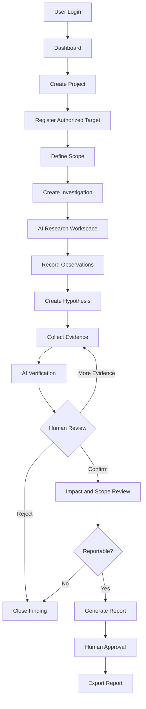

# SENTINEL RESEARCH
# Application Flow & User Journey

**Version:** 1.0

---

## 1. Application Overview

Sentinel Research follows a project-based research structure.

The main hierarchy is:

USER
  |
  v
WORKSPACE
  |
  v
PROJECT
  |
  +-- TARGETS
  |
  +-- SCOPE
  |
  +-- INVESTIGATIONS
         |
         +-- AI CONVERSATIONS
         |
         +-- HYPOTHESES
         |
         +-- OBSERVATIONS
         |
         +-- FINDINGS
         |
         +-- EVIDENCE
         |
         +-- VERIFICATION
         |
         +-- REPORTS

Each project maintains its own research context.

---

## 2. Authentication Flow

### Registration

1. User visits the landing page.
2. User selects Sign Up.
3. User creates an account through the authentication provider.
4. Application verifies the authentication session.
5. Application creates or synchronizes the user profile.
6. User is redirected to onboarding.

### Login

1. User selects Sign In.
2. Authentication provider verifies credentials.
3. Application validates the session.
4. User is redirected to the dashboard.

### Logout

1. User selects Logout.
2. Session is invalidated.
3. User is redirected to the public landing page.

---

## 3. Onboarding Flow

### Step 1: Welcome

Introduce Sentinel Research and explain its purpose.

### Step 2: Experience Level

User selects:

- Beginner.
- Intermediate.
- Advanced.
- Professional.

This controls the level of explanation and guidance, not security permissions.

### Step 3: Research Interests

User selects interests:

- Web application security.
- Bug bounty research.
- Penetration testing.
- API security.
- Security education.

### Step 4: Preferred AI Workflow

User selects:

- Guided Mode.
- Delegated Mode.
- Both.

### Step 5: AI Configuration

Initial release:
- Configure available Claude API access.
- Explain usage and privacy implications.
- Store provider credentials securely.

### Step 6: Dashboard

User enters the research workspace.

---

## 4. Dashboard Flow

The dashboard presents:

- Welcome message.
- Active projects.
- Active investigations.
- Findings awaiting review.
- Recent activity.
- Research progress.
- Quick actions.

Primary actions:

- Create Project.
- Continue Investigation.
- Review Finding.
- Open AI Workspace.

Empty states should guide new users through project creation.

---

## 5. Project Creation Flow

1. User selects Create Project.
2. Application opens project form.
3. User enters:
   - Project name.
   - Description.
   - Project type.
   - Research objective.
4. User submits the form.
5. Backend validates input.
6. Project is created.
7. User is redirected to the project overview.

Project types:

- Learning Lab.
- Bug Bounty.
- Authorized Assessment.
- Internal Security Research.

---

## 6. Target Registration Flow

1. User opens project.
2. User selects Targets.
3. User registers a target or practice environment.
4. User provides target details.
5. User records authorization information.
6. User documents scope.
7. Application validates required fields.
8. Target is saved.

Target information:

- Name.
- Environment type.
- Asset identifier.
- Program URL, where applicable.
- Authorization source.
- Authorization date.
- Expiration date.
- Scope status.

A target cannot be used for active testing unless authorization is explicitly established.

---

## 7. Scope Management Flow

1. User opens target details.
2. User enters allowed assets.
3. User enters excluded assets.
4. User documents permitted activities.
5. User documents prohibited activities.
6. User reviews scope.
7. User confirms the scope record.

Scope changes must create a new version rather than silently overwriting the previous authorization record.

If scope becomes invalid or expires, delegated testing tasks must be blocked.

---

## 8. Investigation Creation Flow

1. User opens a project.
2. User selects Investigations.
3. User selects New Investigation.
4. User enters:
   - Investigation title.
   - Research objective.
   - Associated target.
   - Research category.
   - Initial observations.
5. Application checks project and target authorization records.
6. Investigation is created.
7. Application generates an investigation ID.
8. User enters the investigation workspace.

Investigation status:

- Draft.
- Active.
- Paused.
- Under Review.
- Completed.
- Archived.

---

## 9. AI Research Workspace Flow

### Workspace Layout

The workspace contains:

- Investigation context panel.
- Conversation area.
- Research notes.
- Evidence references.
- Investigation status.
- Suggested next action.

### Guided Mode

1. User asks a research question.
2. Backend retrieves relevant investigation context.
3. AI receives the question and approved context.
4. AI returns an explanation or structured recommendation.
5. User reviews the response.
6. User decides whether to add observations or create a hypothesis.
7. Application records the interaction.

### Delegated Mode

1. User selects a predefined AI task.
2. Application checks task permissions.
3. AI receives the task and relevant context.
4. AI performs permitted analysis.
5. AI produces structured output.
6. Application validates the output.
7. Results are stored as proposed observations or hypotheses.
8. User reviews and accepts, edits or rejects the result.

AI must not directly execute unrestricted security tests.

---

## 10. Hypothesis Management Flow

1. User selects New Hypothesis.
2. User enters a suspected security issue.
3. User selects a vulnerability category.
4. User links supporting observations.
5. Application creates the hypothesis.
6. AI reviews the available context.
7. AI identifies supporting and contradictory information.
8. User decides whether further investigation is justified.

Hypothesis statuses:

- Idea.
- Observed.
- Needs Validation.
- Not Reproducible.
- Rejected.
- Confirmed.

---

## 11. Evidence Management Flow

1. User opens an investigation or finding.
2. User selects Add Evidence.
3. User chooses the evidence type and supplies a title and description.
4. User selects a file within the 25 MB limit and the allowed MIME list.
5. The client provides a redaction step: text can be edited before submission, and images support
   masking or blackout. The user confirms that sensitive information was removed. The platform
   states that client-side redaction cannot be independently guaranteed.
6. The application requests an upload intent. The server checks authentication, workspace access,
   scope, MIME type, size, and the declared checksum, creates a quarantined evidence record, and
   returns an UploadThing upload intent (the local development fallback returns a presigned PUT URL).
7. The client uploads directly through the authenticated UploadThing `evidenceUploader` FileRouter
   route, which enforces ownership, the MIME allowlist, the 25 MB limit, and a single file.
8. The client calls finalize. The server downloads the private object, verifies its size, checksum, and
   magic bytes, runs the advisory sensitive-data scan, and marks the record `NOT_REVIEWED` or
   `QUARANTINED`. The evidence is not active yet.
9. Quarantined evidence is visible only to its uploader and reviewers. It is never linked to a
   finding, sent to AI, or included in a report.
10. A human reviewer resolves redaction:
    - approve without change → `VERIFIED_SAFE`;
    - approve a sanitized replacement → `REDACTED`;
    - reject → the private object is deleted and the uploader must submit a replacement.
11. On approval, the server activates the object in place, re-verifies the checksum, records the
    reviewer, and clears the quarantine state. No copy, rename, or second upload occurs.
12. Approved evidence is linked to the investigation or to a finding through `EvidenceLink` with a
    relationship type (`SUPPORTS`, `CONTRADICTS`, `CONTEXT`, or `REPRODUCTION`).
13. User can review its history.

Files outside the MIME allowlist, files above 25 MB, empty files, and files whose detected type does
not match the declaration are rejected. HTML and SVG are never accepted.

Evidence is immutable once activated. Corrections create a new version with `version` and
`supersedesId`; the superseded record remains for history. Deletion is soft and is blocked while the
evidence is linked to a finding.

---

## 12. Verification Flow

1. User submits a finding for review.
2. Application retrieves the relevant investigation context.
3. Verification assistant reviews the evidence.
4. AI identifies:
   - Supporting evidence.
   - Contradictory evidence.
   - Missing evidence.
   - Impact uncertainty.
   - Reproducibility concerns.
5. AI returns a structured review.
6. User reviews the result.
7. User accepts, rejects or requests additional evidence.
8. Application records the final human decision.

Possible conclusions:

- Needs More Evidence.
- Not Reproducible.
- False Positive.
- Confirmed.

Reportability is a separate decision requiring scope and impact review.

---

## 13. Report Generation Flow

1. User selects an investigation that contains confirmed or reportable findings.
2. User selects one or more findings and creates a report.
3. Application retrieves the selected finding details and only approved evidence linked to them.
4. Application creates the first immutable revision using Markdown, with separate sections for
   summary, findings, evidence references, assumptions and limitations, and missing information.
5. User reviews and edits the Markdown, saving a new revision when needed.
6. Application validates report readiness before submission and again before approval.
7. A human reviewer approves the report.
8. User exports Markdown. The export event is audited and the report moves to `EXPORTED`.
9. User may return an under-review report to draft for revisions or archive the report.

Reports retain the finding and evidence references used by each revision, including evidence
version and checksum. A report cannot include a finding that is not `CONFIRMED` or `REPORTABLE`, and
cannot include evidence that has not passed redaction review.

---

## 14. Investigation Continuation Flow

When a user returns:

1. Application loads the investigation.
2. Application retrieves its current status.
3. Application loads the latest session summary.
4. Application retrieves previous observations.
5. Application checks outstanding hypotheses.
6. Application retrieves completed task records.
7. AI presents a concise continuation summary.
8. User selects the next activity.

The AI must not repeat completed research without explaining why.

---

## 15. Main Navigation

### Sidebar

**Workspace**
- Dashboard
- Projects
- Investigations

**Research**
- Targets
- Findings
- Evidence
- Reports

**AI**
- Research Workspace
- AI Configuration

**Account**
- Settings
- Profile
- Help

---

## 16. Critical Error and Exception Flows

### Expired Authorization
- Block testing-related delegated tasks.
- Display authorization warning.
- Require updated authorization.

### Missing Evidence
- Prevent confirmation.
- Explain missing evidence.
- Allow additional documentation.

### AI Failure
- Preserve existing investigation state.
- Mark task as failed.
- Allow retry.
- Avoid duplicate task execution.

### Duplicate Hypothesis
- Identify similar existing hypotheses.
- Show previous investigation.
- Allow the user to link to or reopen the existing record.

### Unauthorized Access
- Reject the request server-side.
- Record the security event.
- Do not expose private record information.

### Provider Unavailability
- Display provider status.
- Preserve conversation and task context.
- Allow retry or provider switching where configured.

---

## 17. Core Flow Diagram

---

## 18. UX Acceptance Criteria

- Users can understand the next action from every major screen.
- Users can resume previous investigations.
- Investigation context is not lost between sessions.
- Findings display their verification status.
- Evidence is accessible from its associated finding.
- Scope warnings are visible.
- AI suggestions are distinguishable from human decisions.
- Errors do not erase previous investigation data.
- Users can understand why an investigation was rejected or paused.