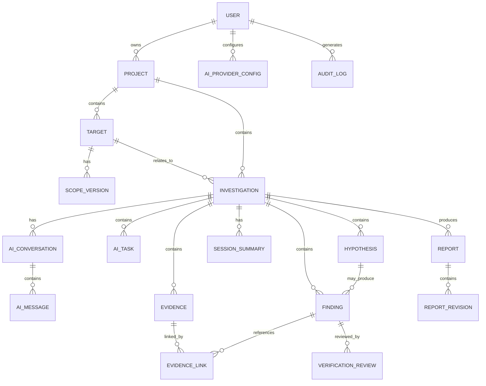

# SENTINEL RESEARCH

# Database Schema & Data Architecture

**Version:** 1.0
**Database:** PostgreSQL, neon
**ORM:** Prisma

---

## 1. Database Design Overview

The database must support:

- Individual research workspaces.
- Multiple projects.
- Authorized targets.
- Versioned scope records.
- Persistent investigations.
- AI conversations.
- AI tasks.
- Hypotheses.
- Findings.
- Evidence.
- Verification reviews.
- Reports.
- Audit history.

The schema should prioritize relational integrity, ownership isolation and traceability.

### Design Principles

1. Use UUIDs for primary identifiers.
2. Every user-owned resource must have an ownership path.
3. Use explicit foreign-key relationships.
4. Keep investigation history persistent.
5. Separate AI suggestions from human decisions.
6. Keep uploaded files outside the relational database.
7. Store file metadata and object-storage references in PostgreSQL.
8. Maintain audit history for important actions.
9. Preserve evidence references.
10. Version scope and report records where necessary.

---

## 2. Entity Relationship Overview

---

## 3. Core Models

### 3.1 User

Represents an authenticated application user.

Fields:

- id
- authProviderId
- email
- displayName
- avatarUrl
- experienceLevel
- preferredMode
- createdAt
- updatedAt

Relationships:

- Projects.
- AI provider configurations.
- Audit logs.

Authentication credentials remain with the authentication provider.

### 3.2 Workspace

Represents a research workspace.

Fields:

- id
- name
- slug
- ownerId
- description
- createdAt
- updatedAt

MVP consideration:

The initial application can use one personal workspace per user while retaining the Workspace entity for future team support.

### 3.3 WorkspaceMember

Represents membership in a workspace.

Fields:

- id
- workspaceId
- userId
- role
- joinedAt

Roles:

- OWNER
- ADMIN
- RESEARCHER
- REVIEWER

Team collaboration is reserved for a later release.

### 3.4 Project

Fields:

- id
- workspaceId
- ownerId
- name
- slug
- description
- projectType
- status
- createdAt
- updatedAt
- archivedAt

Project types:

- LEARNING_LAB
- BUG_BOUNTY
- AUTHORIZED_ASSESSMENT
- INTERNAL_RESEARCH

Project statuses:

- ACTIVE
- PAUSED
- COMPLETED
- ARCHIVED

Relationships:

- Targets.
- Investigations.
- Reports.

### 3.5 Target

Fields:

- id
- projectId
- name
- description
- assetIdentifier
- assetType
- environmentType
- authorizationStatus
- authorizationSource
- authorizationExpiresAt
- createdAt
- updatedAt

Asset types:

- DOMAIN
- APPLICATION
- API
- IP_ASSET
- LOCAL_LAB
- OTHER

Environment types:

- PRACTICE_LAB
- BUG_BOUNTY_PROGRAM
- AUTHORIZED_ASSESSMENT
- INTERNAL_ENVIRONMENT

Authorization statuses:

- PENDING
- AUTHORIZED
- EXPIRED
- REVOKED
- UNVERIFIED

An unverified target may be documented but cannot be used for active testing.

### 3.6 ScopeVersion

Represents a version of a target's authorization boundaries.

Fields:

- id
- targetId
- version
- status
- allowedAssets
- excludedAssets
- permittedActivities
- prohibitedActivities
- authorizationEvidenceId
- effectiveFrom
- effectiveUntil
- createdBy
- createdAt

Statuses:

- DRAFT
- ACTIVE
- EXPIRED
- REVOKED

A scope change creates a new version.

Previous versions remain available for audit purposes.

### 3.7 Investigation

Represents one research investigation.

Fields:

- id
- projectId
- targetId
- title
- description
- objective
- category
- status
- createdBy
- startedAt
- completedAt
- createdAt
- updatedAt

Statuses:

- DRAFT
- ACTIVE
- PAUSED
- UNDER_REVIEW
- COMPLETED
- ARCHIVED

Relationships:

- Conversations.
- AI tasks.
- Hypotheses.
- Findings.
- Evidence.
- Session summaries.
- Reports.

### 3.8 InvestigationObservation

Stores observations recorded during research.

Fields:

- id
- investigationId
- title
- description
- observationType
- source
- confidenceLabel
- createdBy
- createdAt

Observation types:

- APPLICATION_BEHAVIOUR
- ROUTE_INFORMATION
- HTTP_METADATA
- USER_NOTE
- AI_OBSERVATION
- OTHER

Observations must distinguish direct evidence from interpretations.

### 3.9 Hypothesis

Represents a suspected security issue.

Fields:

- id
- investigationId
- title
- description
- vulnerabilityCategory
- supportingObservations
- contradictingObservations
- missingInformation
- status
- createdBy
- createdAt
- updatedAt

Statuses:

- IDEA
- OBSERVED
- NEEDS_VALIDATION
- NOT_REPRODUCIBLE
- REJECTED
- CONFIRMED

A hypothesis is not automatically a vulnerability finding.

### 3.10 Finding

Represents a potential or established security issue.

Fields:

- id
- investigationId
- hypothesisId
- title
- description
- vulnerabilityCategory
- severity
- status
- impact
- remediation
- verifiedAt
- createdBy
- approvedBy
- createdAt
- updatedAt

Statuses:

- DRAFT
- NEEDS_VALIDATION
- UNDER_REVIEW
- CONFIRMED
- FALSE_POSITIVE
- REJECTED
- REPORTABLE
- CLOSED

Severity:

- INFORMATIONAL
- LOW
- MEDIUM
- HIGH
- CRITICAL
- UNASSESSED

Severity and reportability must be reviewed separately.

### 3.11 Evidence

Represents a supporting research artifact. Evidence belongs to exactly one investigation and is
scoped to a workspace (ADR-004).

Fields:

- id
- workspaceId
- investigationId
- evidenceType
- title
- description
- fileName
- storageKey (null while quarantined; unique when active)
- quarantineKey (null once active; unique while quarantined)
- mimeType
- fileSize
- checksum
- source
- redactionStatus
- redactionMethod
- scanFindings (advisory scan counts and categories, never matched values)
- uploadedBy
- redactionReviewedBy
- redactionReviewedAt
- activatedAt
- version
- supersedesId
- deletedAt
- createdAt
- updatedAt

`projectId` is derived through the investigation. There is no `findingId` on evidence; findings are
linked through `EvidenceLink`.

Evidence types:

- SCREENSHOT
- HTTP_REQUEST
- HTTP_RESPONSE
- TEXT_OBSERVATION
- DOCUMENT
- LOG
- EXTERNAL_REFERENCE
- REPRODUCTION_NOTE
- OTHER

Redaction statuses:

- NOT_REVIEWED
- QUARANTINED
- REDACTED
- VERIFIED_SAFE

Redaction methods:

- NONE
- CLIENT_MASK
- HUMAN_REVIEW

Store binary content in private object storage, not PostgreSQL. Objects live under a quarantined key
until a human reviewer resolves redaction, then under an immutable active key
(`quarantine/{workspaceId}/{evidenceId}/{uploadId}` and
`evidence/{workspaceId}/{investigationId}/{evidenceId}/v{version}`). Corrections create a new
`version` with `supersedesId` rather than overwriting the active object, and deletion is soft via
`deletedAt` (ADR-004, ADR-013, ADR-019).

### 3.12 EvidenceLink

Connects evidence to findings.

Fields:

- id
- evidenceId
- findingId
- relationshipType
- createdAt

Relationship types:

- SUPPORTS
- CONTRADICTS
- CONTEXT
- REPRODUCTION

Unique `(evidenceId, findingId, relationshipType)`. Only `REDACTED` or `VERIFIED_SAFE` evidence may
be linked. This allows evidence to be reused across related findings without duplicating files.

---

## 4. AI Data Models

### 4.1 AIProviderConfig

Stores a user's AI provider configuration.

Fields:

- id
- userId
- provider
- displayName
- encryptedCredentialReference
- defaultModel
- isActive
- createdAt
- updatedAt

Do not store unencrypted API credentials.

Prefer a managed secrets system or an encrypted credential vault.

### 4.2 AIConversation

Fields:

- id
- investigationId
- title
- mode
- provider
- model
- status
- createdAt
- updatedAt

Modes:

- GUIDED
- DELEGATED

### 4.3 AIMessage

Fields:

- id
- conversationId
- role
- content
- structuredContent
- tokenUsage
- createdAt

Roles:

- USER
- ASSISTANT
- SYSTEM
- TOOL

System instructions should be managed through controlled server-side templates, not user-editable message records.

### 4.4 AITask

Represents an assigned AI task.

Fields:

- id
- investigationId
- conversationId
- taskType
- status
- assignedRole
- inputContext
- output
- errorMessage
- tokenUsage
- startedAt
- completedAt
- createdAt

Task types:

- RECON_ANALYSIS
- ATTACK_SURFACE_ANALYSIS
- HYPOTHESIS_GENERATION
- EVIDENCE_REVIEW
- FALSE_POSITIVE_REVIEW
- FINDING_SUMMARY
- REPORT_GENERATION
- SESSION_SUMMARY

Statuses:

- PENDING
- RUNNING
- AWAITING_APPROVAL
- COMPLETED
- FAILED
- CANCELLED

### 4.5 AITaskEvent

Maintains task history.

Fields:

- id
- taskId
- eventType
- description
- metadata
- createdAt

Events:

- TASK_CREATED
- TASK_STARTED
- CONTEXT_ASSEMBLED
- RESPONSE_RECEIVED
- RESPONSE_VALIDATED
- REVIEW_REQUIRED
- TASK_COMPLETED
- TASK_FAILED
- TASK_CANCELLED

### 4.6 VerificationReview

Stores AI and human review records.

Fields:

- id
- findingId
- taskId
- reviewerType
- reviewerId
- conclusion
- supportingEvidence
- contradictingEvidence
- missingEvidence
- impactAssessment
- reasoningSummary
- createdAt

Reviewer types:

- AI
- HUMAN

Conclusions:

- NEEDS_MORE_EVIDENCE
- NOT_REPRODUCIBLE
- FALSE_POSITIVE
- CONFIRMED

Human approval must be represented independently from AI review.

### 4.7 SessionSummary

Stores investigation continuation context.

Fields:

- id
- investigationId
- summary
- completedWork
- rejectedHypotheses
- unresolvedQuestions
- nextActions
- createdBy
- createdAt

This model is central to persistent investigation memory.

---

## 5. Reporting Models

### Report

A report belongs to exactly one investigation and may include one or more findings from that
investigation.

Fields:

- id
- workspaceId
- investigationId
- templateId (optional)
- title
- status
- format
- createdBy
- approvedBy
- approvedAt
- archivedAt
- createdAt
- updatedAt

Statuses:

- DRAFT
- UNDER_REVIEW
- APPROVED
- EXPORTED
- ARCHIVED

### ReportFinding

Fields:

- id
- reportId
- findingId
- position

Each finding may appear once per report. The position defines the order used by the renderer.

### ReportTemplate

Fields:

- id
- workspaceId (null for system templates)
- name
- version
- scope (`SYSTEM` or `WORKSPACE`)
- sectionSchema
- isActive
- createdBy
- createdAt
- updatedAt

Templates are versioned. A template change does not rewrite historical report revisions.

### ReportRevision

Fields:

- id
- reportId
- version
- content
- evidenceSnapshot
- findingSnapshot
- generatedByType (`HUMAN` or `AI_ASSISTED`)
- model
- promptVersion
- createdBy
- createdAt

Each revision preserves the evidence references used at generation time, including evidence ID,
title, type, relationship, version, and checksum, plus the included finding IDs and their statuses.
Revisions are uniquely numbered per report and are immutable.

---

## 6. Audit Logging

### AuditLog

Fields:

- id
- workspaceId
- userId
- entityType
- entityId
- action
- previousValue
- newValue
- metadata
- createdAt

Record important events:

- Project creation.
- Scope modification.
- Investigation creation.
- Evidence changes.
- Finding status changes.
- Human approvals.
- Report approval.
- AI task execution.
- Permission changes.

Avoid storing secrets or sensitive raw content in audit metadata.

---

## 7. Important Database Constraints

1. Every project must belong to a workspace.
2. Every investigation must belong to a project.
3. Every target must belong to a project.
4. Every finding must belong to an investigation.
5. Every evidence record must have an authorized owner path.
6. Every AI task must reference an investigation.
7. Scope versions must be uniquely numbered per target.
8. Report revisions must be uniquely numbered per report.
9. AI task events must reference existing tasks.
10. Human approval must reference an authenticated user.

---

## 8. Recommended Indexes

Add indexes for:

- User authentication ID.
- Workspace ID.
- Project ID.
- Target ID.
- Investigation ID.
- Finding status.
- Evidence investigation ID.
- AI task status.
- AI conversation ID.
- Created timestamps.

Use compound indexes for common workspace and status queries.

---

## 9. Data Retention and Deletion

- Users can archive projects.
- Investigations should retain history while active.
- Evidence deletion should follow an explicit retention policy.
- Report revisions should remain traceable.
- AI conversations should have configurable retention.
- Account deletion must handle associated user data and storage objects.
- Audit records should follow the applicable retention policy.

---

## 10. MVP Database Priority

### Phase 1

- User.
- Workspace.
- Project.
- Target.
- ScopeVersion.
- Investigation.

### Phase 2

- InvestigationObservation.
- Hypothesis.
- Finding.
- Evidence.
- EvidenceLink.

### Phase 3

- AIProviderConfig.
- AIConversation.
- AIMessage.
- AITask.
- AITaskEvent.
- VerificationReview.
- SessionSummary.

### Phase 4

- Report.
- ReportRevision.
- AuditLog.
- WorkspaceMember.

---

## 11. Schema Design Rule

The database must preserve the distinction between:

- What the user observed.
- What AI inferred.
- What evidence established.
- What AI recommended.
- What a human approved.

These are separate records and must never be collapsed into one generic finding description.
