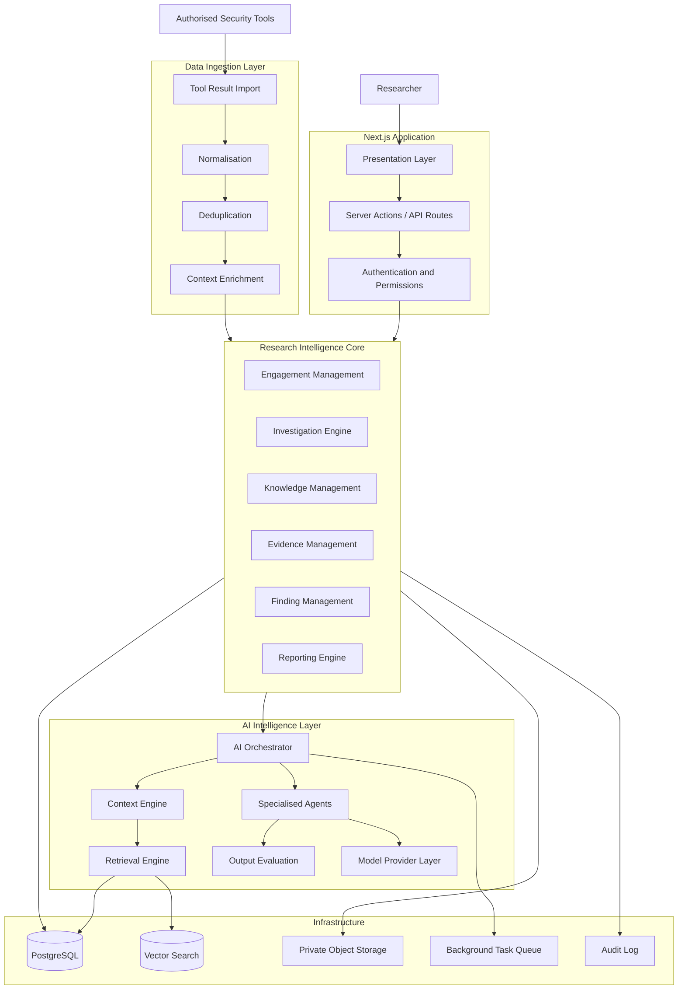
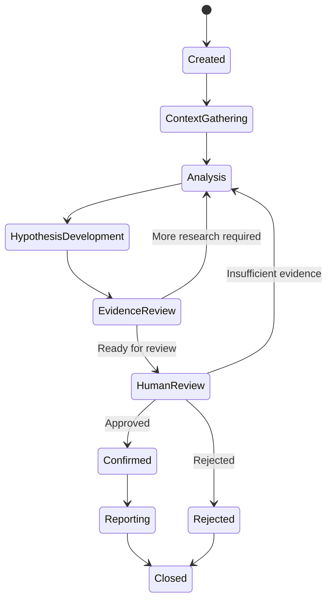
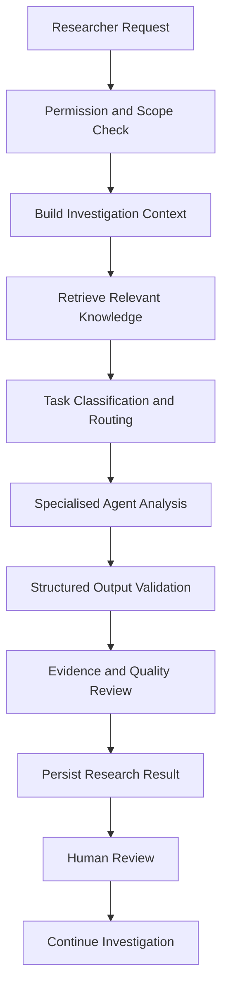
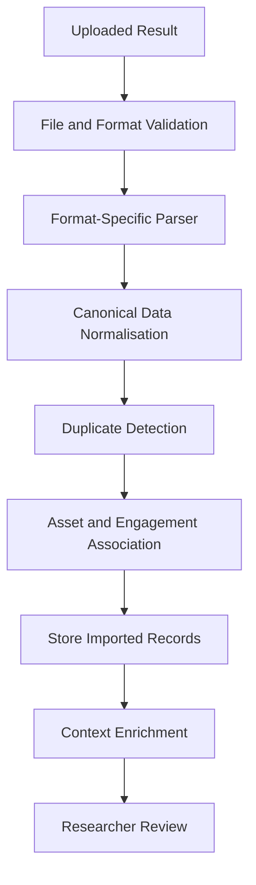
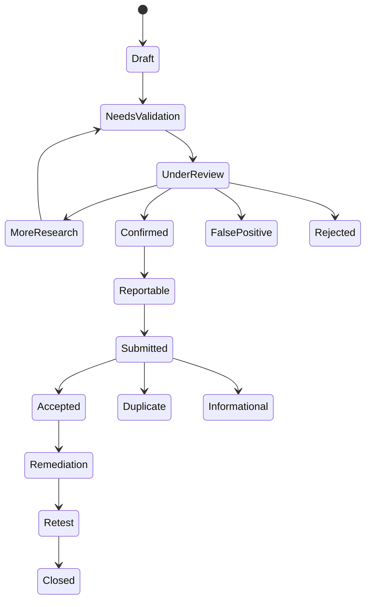

# SENTINEL RESEARCH
## Revised Technical Architecture — V2

**Product:** Sentinel Research  
**Architecture:** Research-Intelligence Platform  
**Architecture Style:** Modular Monolith + Event-Driven AI Orchestration  
**Primary AI Provider:** Anthropic Claude  
**Database:** PostgreSQL + Prisma ORM  
**Application:** Next.js App Router + TypeScript  
**Package Manager:** Yarn

---

# 1. Architectural Vision

Sentinel Research V2 evolves the existing application from an AI-assisted security workspace into an evidence-centred research-intelligence platform.

The objective is not to build another vulnerability scanner or a chatbot with specialised prompts.

The objective is to create a system that helps security researchers:

1. Understand the security context of an authorised engagement.
2. Organise and correlate observations from different sources.
3. Recognise relationships between findings and known vulnerability patterns.
4. Develop and manage research hypotheses.
5. Evaluate evidence and identify unsupported conclusions.
6. Preserve investigation knowledge across sessions.
7. Produce reliable, human-reviewed security findings.
8. Track remediation and authorised retesting.

The system should make AI more useful by providing it with structured context, relevant historical information, specialised analytical workflows and reliable evidence.

## Core architectural principle

**The model provides reasoning. Sentinel provides context, knowledge, orchestration, evidence management, validation and workflow control.**

The application must remain useful when AI providers are unavailable.

---

# 2. What Changes From V1

V1 already provides the foundation:

- User authentication and workspace.
- Projects and targets.
- Scope management.
- Investigations.
- AI assistant.
- Guided and delegated modes.
- Evidence management.
- Findings and verification.
- Persistent investigation context.
- Reporting.
- Dashboard and activity tracking.

These features should be preserved where they are working correctly.

V2 introduces deeper intelligence and research capabilities.

| Existing V1 capability | V2 evolution |
|---|---|
| AI conversations | Context-aware research orchestration |
| Investigation memory | Structured research knowledge and decision history |
| AI agents | Specialised analytical agents with defined responsibilities |
| Findings | Evidence-linked, traceable finding lifecycle |
| Evidence management | Evidence provenance, relationships and quality evaluation |
| Target management | Engagement intelligence and scope-aware asset context |
| AI analysis | Multi-stage analysis and independent review |
| Reports | Evidence-backed, human-approved reporting |
| Dashboard | Research intelligence and investigation insights |

V2 is an architectural upgrade, not a complete rewrite.

---

# 3. Target Architecture

The architecture remains a modular monolith with clear domain boundaries.

The AI system becomes a separate internal subsystem with its own orchestration, context, retrieval, evaluation and task-management components.

## High-level architecture



The vector search component is an extension of the knowledge system, not a replacement for PostgreSQL.

---

# 4. Core Domain Architecture

The application should be organised around the following domains.

## 4.1 Engagement Management

Responsible for managing the context and authorisation of security research.

An engagement can represent:

- A bug bounty program.
- An independent security assessment.
- A client security audit.
- An authorised internal assessment.
- A controlled learning or laboratory environment.

Responsibilities:

- Engagement creation.
- Engagement objectives.
- Target and asset association.
- Scope and exclusions.
- Authorisation records.
- Engagement dates.
- Restrictions and permitted activities.
- Engagement status.

Important rule:

Every testing-related task must be associated with an active, authorised engagement and its applicable scope.

Unverified or unauthorised targets may be documented, but must not be used to initiate testing workflows.

## 4.2 Investigation Engine

This becomes one of Sentinel's most important domains.

An investigation is not simply an AI conversation.

It is a structured record of a research process.

Each investigation should contain:

- Initial observation.
- Related assets.
- Engagement context.
- Research objectives.
- Observations.
- Hypotheses.
- Supporting evidence.
- Contradictory evidence.
- Related historical research.
- AI analysis records.
- Research decisions.
- Unresolved questions.
- Final outcome.

An investigation should retain its history even after a hypothesis is rejected.

### Investigation lifecycle



AI must never automatically move a finding into a human-approved state.

## 4.3 Research Knowledge Management

This is a major new architectural capability.

V1's persistent conversation context should evolve into structured research knowledge.

The system should maintain four categories of knowledge.

### A. Investigation knowledge

Information belonging to an individual investigation:

- Observations.
- Hypotheses.
- Evidence.
- Research decisions.
- Unresolved questions.
- Investigation summaries.

### B. Engagement knowledge

Information shared across investigations belonging to an engagement:

- Authorised assets.
- Scope versions.
- Engagement objectives.
- Previously identified issues.
- Known limitations.
- Relevant assessment history.

### C. Research reference knowledge

Curated information that helps explain security concepts and recognised vulnerability patterns:

- Vulnerability classifications.
- Security testing concepts.
- Public advisories.
- Relevant CVEs.
- Public vulnerability write-ups.
- Security standards.
- Remediation patterns.
- Trusted technical references.

Store the original source, publication date, retrieval date and source URL where available.

### D. User research knowledge

Information about a researcher's own documented experience:

- Previously investigated patterns.
- Rejected hypotheses.
- Lessons from completed investigations.
- Research notes.
- Preferred investigation workflows.

Do not treat every AI-generated response as established knowledge.

Knowledge records must have provenance and a confidence or review status.

### Knowledge architecture

Use PostgreSQL as the primary source of truth.

Introduce semantic retrieval through PostgreSQL vector search, using pgvector where supported.

Recommended retrieval strategy:

1. Exact database filtering.
2. Full-text search.
3. Semantic similarity search.
4. Relevance ranking.
5. Context assembly.

Semantic similarity alone must never determine whether two vulnerabilities are identical.

---

# 5. Research Intelligence Layer

This is the most important new subsystem.

Its responsibility is to provide specialised, context-aware analysis rather than send every user message directly to a general-purpose LLM.

## 5.1 AI Orchestrator

The orchestrator coordinates AI tasks.

It should:

- Understand the task type.
- Load the relevant investigation context.
- Retrieve relevant research knowledge.
- Select the appropriate analytical agent.
- Select an available model.
- Apply token and context limits.
- Validate structured output.
- Save results.
- Request human review where necessary.

The orchestrator must not perform all the reasoning itself.

It delegates defined responsibilities to specialised agents.

## 5.2 Specialised agents

### Agent 1: Research Context Agent

**Purpose:** Understand the investigation before analysis begins.

Responsibilities:

- Summarise the current investigation.
- Retrieve previous observations.
- Identify relevant historical investigations.
- Identify missing context.
- Detect repeated research.
- Produce a structured context package.

Output:

- Investigation summary.
- Relevant history.
- Related knowledge.
- Unresolved questions.
- Context confidence.
- Source references.

### Agent 2: Pattern Analysis Agent

**Purpose:** Help identify relationships between observations and known security patterns.

Responsibilities:

- Compare observations with recognised vulnerability categories.
- Identify potentially related observations.
- Retrieve relevant public security references.
- Explain why a pattern may be relevant.
- Identify alternative explanations.
- Highlight what cannot be established from the available evidence.

Output:

- Candidate patterns.
- Related observations.
- Supporting references.
- Alternative explanations.
- Confidence and uncertainty.
- Additional evidence needed.

A pattern match is a research lead, not proof of a vulnerability.

### Agent 3: Hypothesis Development Agent

**Purpose:** Help researchers develop testable research hypotheses.

Responsibilities:

- Convert observations into clearly stated hypotheses.
- Identify assumptions.
- Explain expected versus observed behaviour.
- Identify missing information.
- Suggest safe, scope-compliant ways to investigate the question.
- Track relationships between hypotheses.

Output:

- Hypothesis statement.
- Supporting observations.
- Assumptions.
- Alternative explanations.
- Evidence requirements.
- Current status.

### Agent 4: Evidence Analysis Agent

**Purpose:** Evaluate the quality and relevance of available evidence.

Responsibilities:

- Review submitted evidence.
- Identify missing supporting material.
- Detect contradictions.
- Distinguish direct evidence from interpretation.
- Check whether evidence supports the stated impact.
- Identify duplicate or unrelated evidence.
- Flag potentially sensitive information requiring redaction.

Output:

- Evidence assessment.
- Supporting evidence.
- Contradictory evidence.
- Missing evidence.
- Provenance information.
- Confidence assessment.

This agent evaluates evidence quality. It does not independently establish that a vulnerability exists.

### Agent 5: Verification Agent

**Purpose:** Challenge a potential finding before human approval.

Responsibilities:

- Review the complete investigation.
- Challenge the hypothesis.
- Evaluate supporting and contradictory evidence.
- Identify alternative explanations.
- Assess whether the claimed impact is supported.
- Identify unsupported severity claims.
- Produce a verification recommendation.

Possible recommendations:

- Insufficient evidence.
- More investigation required.
- Potential false positive.
- Evidence supports the hypothesis.
- Human review required.

The final decision belongs to a human reviewer.

### Agent 6: Reporting Agent

**Purpose:** Generate reports from approved investigation data.

Responsibilities:

- Generate clear technical descriptions.
- Organise supporting evidence.
- Describe demonstrated impact.
- Explain remediation recommendations.
- Produce bug bounty report formats.
- Produce formal security audit findings.

It must not invent evidence, reproduction results, impact or testing activities.

## 5.3 Agent orchestration flow



Each agent should have a defined input schema, output schema, permitted operations and responsibility boundary.

Agents should not be able to modify scope, approve their own findings or submit external reports.

---

# 6. Context Engineering and Retrieval

The quality of AI output depends heavily on the quality of the context provided.

Do not send an entire investigation history to the model every time.

Build a dedicated Context Engine.

## Context layers

| Layer | Contents |
|---|---|
| Global | System instructions, safety constraints and output rules |
| Workspace | User preferences and workspace configuration |
| Engagement | Authorisation, scope, objectives and restrictions |
| Project | Targets, assets and assessment history |
| Investigation | Observations, hypotheses, evidence and decisions |
| Session | Recent conversation and current task |
| Reference | Relevant public research and security knowledge |

## Context assembly pipeline

1. Receive an AI task.
2. Identify the task's investigation and engagement.
3. Verify permissions and applicable scope.
4. Retrieve the investigation's current state.
5. Retrieve relevant previous decisions.
6. Search for related observations and findings.
7. Search reference knowledge.
8. Rank results by relevance and recency.
9. Remove irrelevant or duplicated context.
10. Build a bounded context package.
11. Send it to the selected agent.

### Context package example

```typescript
interface ResearchContext {
  engagement: {
    id: string;
    type: string;
    status: string;
    scopeVersionId: string;
    restrictions: string[];
  };

  investigation: {
    id: string;
    objective: string;
    summary: string;
    status: string;
  };

  observations: ObservationContext[];
  hypotheses: HypothesisContext[];
  evidence: EvidenceContext[];
  previousDecisions: DecisionContext[];
  relatedInvestigations: RelatedInvestigation[];
  referenceSources: ReferenceSource[];

  unresolvedQuestions: string[];
}
```

The context builder should preserve source identifiers so that the AI can reference the records it used.

---

# 7. Security Tool Integration and Data Ingestion

Sentinel should not compete with established security tools by recreating their scanning capabilities.

Instead, it should provide a structured way to bring authorised assessment results into a research workflow.

## Supported initial import formats

- JSON.
- CSV.
- SARIF.

Add specific tool adapters incrementally.

Potential integrations include:

- Nmap output.
- OWASP ZAP reports.
- Burp Suite exports.
- Semgrep findings.
- Trivy reports.
- Other supported assessment tool outputs.

Integration support must be based on documented formats and explicit compatibility testing.

## Ingestion pipeline



## Canonical finding format

Imported findings should be converted into a common internal representation.

```typescript
interface ImportedFinding {
  sourceTool: string;
  sourceRecordId?: string;

  title: string;
  description?: string;

  severity?: string;
  confidence?: string;

  assetReference?: string;
  locationReference?: string;

  classification?: string;
  references: string[];

  observedAt?: Date;
  rawRecordId: string;
}
```

Preserve the original imported record alongside its normalised representation.

Do not automatically mark imported findings as confirmed.

## Deduplication

Use multiple signals:

- Source record identifier.
- Asset identity.
- Finding classification.
- Affected component or location.
- Similarity of descriptions.
- Relevant evidence.

Duplicate detection should produce a reviewable relationship, not silently delete records.

---

# 8. Evidence and Finding Intelligence

Evidence must become a first-class part of the research system.

## Evidence provenance

Each evidence record should capture:

- Evidence ID.
- Investigation ID.
- Engagement ID.
- Evidence type.
- Source.
- Collection date.
- Collector.
- Original file reference.
- Checksum.
- Description.
- Redaction status.
- Related observations.
- Related hypotheses.
- Related findings.

Evidence types may include:

- Screenshots.
- Logs.
- Tool output.
- Configuration excerpts.
- Source code excerpts.
- Research notes.
- Imported reports.
- Other approved documentation.

Store files in private object storage and metadata in PostgreSQL.

## Evidence relationships

An evidence item may support more than one observation or hypothesis.

A finding may have multiple supporting and contradictory evidence records.

Use explicit relationship records rather than embedding evidence references into unstructured JSON.

## Finding lifecycle



Human approval is required for confirmation, reportability and closure decisions.

---

# 9. Database Architecture

Keep PostgreSQL and Prisma as the primary persistence layer.

Do not introduce a graph database or separate vector database prematurely.

Use relational models and explicit relationship tables first.

## Existing core models to preserve

- User
- Workspace
- WorkspaceMember
- Project
- Target
- ScopeVersion
- Investigation
- InvestigationObservation
- Hypothesis
- Finding
- Evidence
- EvidenceLink
- AIProviderConfig
- AIConversation
- AIMessage
- AITask
- AITaskEvent
- VerificationReview
- SessionSummary
- Report
- ReportRevision
- AuditLog

## New V2 models

### Engagement models

- Engagement
- EngagementAsset
- EngagementAuthorization

An engagement connects a security assessment to its targets, scope and applicable restrictions.

### Research knowledge models

- KnowledgeDocument
- KnowledgeChunk
- KnowledgeSource
- KnowledgeRelation
- ResearchDecision
- InvestigationRelation

`KnowledgeDocument` represents a research source or structured knowledge record.

`KnowledgeChunk` stores retrievable sections and optional embedding metadata.

`KnowledgeSource` records provenance and external references.

`KnowledgeRelation` connects related knowledge records.

`ResearchDecision` preserves important decisions and their rationale.

`InvestigationRelation` connects investigations with relevant relationships, such as shared assets or similar hypotheses.

### Intelligence models

- AgentDefinition
- AgentRun
- AgentRunStep
- ContextSnapshot
- RetrievalRecord
- ModelExecution
- EvaluationResult

These models provide observability and reproducibility for AI analysis.

### Ingestion models

- Integration
- ImportJob
- ImportRecord
- ImportMapping
- DuplicateCandidate

These support tool-result ingestion and review.

### Validation and remediation models

- EvidenceAssessment
- FindingReview
- RemediationRecord
- RetestRecord

Keep the human decision separate from the AI recommendation.

## Important database principles

1. Use UUID identifiers.
2. Enforce workspace ownership and tenant isolation.
3. Use explicit foreign-key relationships.
4. Preserve investigation history.
5. Version engagement scope.
6. Preserve original imported records.
7. Keep AI-generated content separate from human-approved decisions.
8. Record important changes in audit logs.
9. Encrypt sensitive credentials.
10. Use migrations rather than manual production schema changes.

---

# 10. AI Provider Architecture

Continue using Anthropic as the initial provider, but retain a provider abstraction.

```typescript
interface AIProvider {
  generateText(
    request: AIRequest
  ): Promise<AIResponse>;

  generateStructuredOutput<T>(
    request: StructuredAIRequest<T>
  ): Promise<T>;

  getModelCapabilities(): Promise<ModelCapabilities>;
}
```

Provider implementations:

```text
providers/
  anthropic/
    anthropic.provider.ts
    anthropic.schemas.ts
  openai/
    openai.provider.ts
  google/
    google.provider.ts
  provider.interface.ts
  provider.factory.ts
```

Do not build complex multi-model routing before you have evaluation results showing that it improves performance.

Initially:

- Claude handles the primary reasoning tasks.
- Different agents use task-specific prompts and structured outputs.
- Model selection is configurable.
- Provider failures are handled gracefully.
- Results are logged with model and prompt version information.

Later, introduce model selection based on task complexity, latency, cost and measured performance.

A more expensive model is not automatically a better model for every task.

---

# 11. Output Evaluation and Quality Control

This is essential.

A system that produces convincing but unsupported security conclusions is dangerous and not useful.

Every AI result should be evaluated before it becomes part of the investigation's authoritative record.

## Evaluation dimensions

| Dimension | What is evaluated |
|---|---|
| Evidence alignment | Does the result reflect the supplied evidence? |
| Source traceability | Can claims be traced to actual records or references? |
| Factual consistency | Does it contradict known investigation information? |
| Uncertainty | Does it communicate what cannot be established? |
| Relevance | Does it answer the assigned research task? |
| Duplicate awareness | Does it repeat an existing hypothesis or conclusion? |
| Scope compliance | Does the recommendation respect engagement restrictions? |
| Output validity | Does it conform to the required schema? |

## Claim-level provenance

Important AI claims should identify their basis.

Use a structure similar to:

```typescript
interface ResearchClaim {
  statement: string;

  claimType:
    | "observation"
    | "inference"
    | "recommendation"
    | "unknown";

  supportingRecordIds: string[];
  contradictoryRecordIds: string[];

  confidence: number;
  limitations: string[];
}
```

Confidence scores are model estimates, not proof or calibrated probabilities unless separately validated.

The application should visually distinguish:

- Researcher-provided observations.
- Imported tool results.
- AI-generated interpretations.
- Public reference material.
- Human-reviewed conclusions.

## Evaluation dataset

Create a controlled evaluation dataset containing:

- Supported findings.
- False positives.
- Incomplete observations.
- Contradictory evidence.
- Duplicate findings.
- Unsupported severity claims.
- Ambiguous research situations.

Measure:

- Unsupported claim rate.
- Evidence citation accuracy.
- False-positive recommendation rate.
- Duplicate detection quality.
- Structured output validity.
- Human reviewer agreement.
- Context retrieval relevance.

Do not measure quality solely by how confident or detailed the AI sounds.

---

# 12. Application and Infrastructure Architecture

Retain the existing modular monolith.

Recommended internal structure:

```text
src/
  app/
    (marketing)/
    (auth)/
    (dashboard)/
    api/

  components/
    ui/
    layout/
    engagement/
    investigation/
    knowledge/
    evidence/
    findings/
    intelligence/
    integrations/
    reports/

  modules/
    auth/
    workspace/
    engagement/
    projects/
    targets/
    scope/
    investigation/
    observations/
    hypotheses/
    knowledge/
    evidence/
    findings/
    verification/
    remediation/
    reporting/
    integrations/
    audit/

  intelligence/
    orchestrator/
    agents/
      context/
      pattern-analysis/
      hypothesis/
      evidence-analysis/
      verification/
      reporting/
    context/
    retrieval/
    evaluation/
    providers/
    prompts/
    schemas/
    task-management/

  ingestion/
    parsers/
    normalizers/
    deduplication/
    adapters/
    pipelines/

  infrastructure/
    database/
    storage/
    queue/
    secrets/
    logging/

  lib/
    permissions/
    validation/
    errors/
    utilities/

  hooks/
  types/
  config/
```

Each module should own its business logic, schemas and service interfaces.

Do not allow components to query Prisma directly.

Use application services to coordinate domain operations.

Use repositories where they genuinely isolate persistence concerns, rather than creating unnecessary abstractions for every query.

---

# 13. Background Processing

Some operations should not run inside ordinary request-response cycles.

Use background jobs for:

- Large tool-result imports.
- Document processing.
- Knowledge chunking.
- Embedding generation.
- Large retrieval tasks.
- Multi-agent research workflows.
- Report generation.
- Long-running AI evaluations.

Start with a persistent database-backed task queue if V1 already has a suitable task system.

Introduce a dedicated job platform such as Inngest or Trigger.dev when retries, scheduling, concurrency and long-running workflows justify it.

Every job should support:

- Task status.
- Progress events.
- Retry policy.
- Error recording.
- Cancellation where safe.
- Idempotency.
- Audit history.

Do not execute AI tasks without recording their inputs, outputs and execution metadata.

---

# 14. Security Architecture

Sentinel is a security research platform, so its own security architecture must be taken seriously.

## Authorisation controls

- Every assessment must have a documented engagement.
- Every testing-related task must pass server-side scope validation.
- Scope versions must be immutable.
- Expired or revoked authorisation blocks new testing tasks.
- Excluded assets must never be treated as permitted targets.
- Imported records must retain their source and engagement association.

## AI controls

- AI cannot grant authorisation.
- AI cannot expand engagement scope.
- AI cannot approve its own findings.
- AI cannot independently submit reports.
- AI cannot execute unrestricted terminal or browser operations.
- AI recommendations must respect the permissions of the user and engagement.
- Tool execution, where introduced, must use explicit allowlists, bounded operations and human approval.

## Data security

- Encrypt sensitive credentials.
- Keep evidence files private.
- Validate uploaded file types and sizes.
- Scan and safely process untrusted uploads.
- Redact sensitive evidence before external model submission.
- Apply access control to every workspace-owned record.
- Maintain audit logs.
- Avoid logging API keys, tokens or sensitive evidence content.

Treat imported documents, tool output and external research sources as untrusted data, never as instructions to the AI orchestrator.

---

# 15. API and Service Boundaries

Keep API endpoints organised around domain operations.

Example:

```text
/api/engagements
/api/engagements/[id]/scope

/api/investigations
/api/investigations/[id]/observations
/api/investigations/[id]/hypotheses
/api/investigations/[id]/decisions

/api/knowledge/search
/api/knowledge/documents

/api/intelligence/tasks
/api/intelligence/tasks/[id]
/api/intelligence/tasks/[id]/events

/api/evidence
/api/evidence/[id]/assessments

/api/findings
/api/findings/[id]/reviews

/api/integrations/imports
/api/integrations/imports/[id]

/api/reports
/api/reports/[id]
```

These are suggested boundaries, not a requirement to expose every internal service through HTTP.

Use server-side application services for internal operations.

---

# 16. Implementation Strategy: V1 to V2

Do not rebuild V1.

Implement the architecture in controlled phases.

## Phase 0 — V1 Architecture Audit

Before changing code:

- Inspect the existing Prisma schema.
- Inspect current AI orchestration.
- Inspect investigation context and memory.
- Inspect evidence and finding relationships.
- Inspect task handling.
- Inspect authentication and permissions.
- Identify duplicated services.
- Identify existing functionality that can be reused.

Deliverable: a V1-to-V2 architecture gap report.

Do not delete or replace existing modules before understanding their dependencies.

## Phase 1 — Research Data Foundation

Implement:

- Engagement domain.
- Engagement authorisation and scope association.
- ResearchDecision.
- InvestigationRelation.
- KnowledgeDocument.
- KnowledgeSource.
- KnowledgeRelation.

Preserve existing investigation and evidence records.

Add database migrations and tests.

## Phase 2 — Research Knowledge Engine

Implement:

- Knowledge ingestion.
- Document chunking.
- Metadata and source tracking.
- PostgreSQL full-text search.
- pgvector integration.
- Hybrid retrieval.
- Relevance ranking.
- Investigation context assembly.

Do not build an elaborate knowledge graph before relational relationships and retrieval are working.

## Phase 3 — Intelligence Orchestration V2

Refactor the existing AI assistant into:

- Central orchestrator.
- Context agent.
- Pattern analysis agent.
- Hypothesis agent.
- Evidence analysis agent.
- Verification agent.
- Reporting agent.

Add:

- Agent run tracking.
- Structured output schemas.
- Prompt versioning.
- Context snapshots.
- Model execution logs.
- Evaluation records.

Initially, implement these as logical agents within the same application, not separate services.

## Phase 4 — Tool Result Ingestion

Implement:

- Import job management.
- JSON parser.
- CSV parser.
- SARIF parser.
- Canonical finding model.
- Duplicate candidate detection.
- Asset association.
- Researcher review.

Add specific tool adapters incrementally.

## Phase 5 — Evidence and Finding Intelligence

Implement:

- Evidence provenance.
- Evidence assessments.
- Supporting and contradictory relationships.
- Finding review workflow.
- Human approval.
- Remediation records.
- Retest records.

## Phase 6 — Reporting and Product Integration

Implement:

- Bug bounty report templates.
- Security audit report templates.
- Evidence-linked report generation.
- Report revisions.
- Submission tracking.
- Remediation status.
- Investigation analytics.

## Phase 7 — Evaluation and Hardening

Implement:

- AI evaluation dataset.
- Regression tests.
- Retrieval quality evaluation.
- False-positive evaluation.
- Tenant isolation tests.
- Scope enforcement tests.
- File upload security tests.
- Background job reliability tests.
- Performance monitoring.

---

# 17. What NOT to Build Yet

Avoid unnecessary complexity.

Do not introduce these prematurely:

1. Microservices.
2. Multiple autonomous AI agents running independently.
3. A separate graph database.
4. A separate vector database when pgvector is sufficient.
5. Unrestricted AI browser or terminal execution.
6. Autonomous vulnerability exploitation.
7. Automatic vulnerability confirmation.
8. Complex multi-model routing without evaluation data.
9. A large knowledge graph with no proven retrieval benefit.
10. An elaborate workflow engine before the core investigation lifecycle works.

Build the smallest architecture that supports the intended research workflow reliably.

---

# 18. V2 Definition of Done

Sentinel Research V2 should meet the following conditions:

### Research intelligence

- AI can retrieve relevant investigation history.
- AI can connect related observations and research records.
- AI can reference the evidence behind important claims.
- AI can identify missing information and contradictions.
- AI distinguishes known facts from interpretations.

### Evidence and validation

- Evidence has provenance.
- Findings have traceable supporting records.
- Human reviewers can approve or reject conclusions.
- AI cannot silently change a human decision.
- Reports only present approved conclusions as confirmed findings.

### Tool integrations

- Supported result formats can be imported.
- Imported results are normalised.
- Original source records are preserved.
- Duplicate candidates can be reviewed.
- Results are associated with the appropriate authorised engagement.

### Security

- Scope is checked server-side.
- Workspace isolation is enforced.
- Sensitive files remain private.
- AI tasks are auditable.
- Untrusted imported content cannot override system instructions.

### Reliability

- AI failures do not corrupt investigations.
- Background jobs can retry safely.
- Important AI executions can be inspected.
- The application remains useful without an AI provider.

---

# 19. Final Architectural Position

Sentinel Research should be built around five major capabilities:

1. **Research Intelligence:** Understand observations, identify patterns and develop research hypotheses.
2. **Knowledge Engine:** Preserve and retrieve relevant knowledge across investigations.
3. **Evidence Intelligence:** Evaluate evidence, identify contradictions and challenge unsupported claims.
4. **Research Orchestration:** Coordinate specialised AI analysis with traceable execution and human control.
5. **Assessment Workflow:** Manage engagements, imported results, findings, reporting, remediation and retesting.

The differentiator must be demonstrated through measurable research outcomes, not the number of agents or features.

The ultimate product objective is:

**Help security researchers make better-informed decisions, spend less time repeating research, and produce more reliable, evidence-backed security findings.**

---

# 20. Implementation Instruction

Do not ask Claude Code to implement the entire architecture in one operation.

First, instruct it to audit the existing V1 repository and compare the actual implementation against this architecture.

It must produce:

- Existing architecture map.
- Existing Prisma model inventory.
- Existing AI workflow map.
- Reusable modules.
- Architectural weaknesses.
- Missing V2 capabilities.
- Database migration plan.
- Ordered implementation backlog.
- Risks and dependencies.

Only after reviewing that audit should implementation begin.

**Preserve working V1 functionality. Prefer incremental refactoring and additive database migrations over destructive rewrites.**