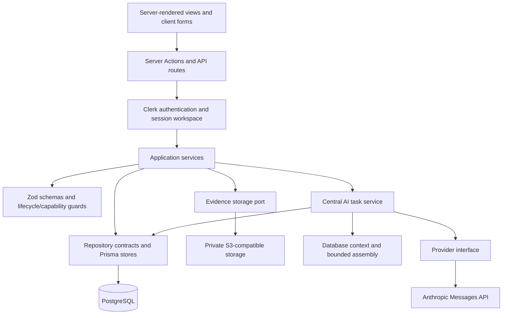

# Sentinel Research V1 architecture audit

Audit date: 2026-11-07. Basis: the pre-implementation V1 working tree and [Revised Technical Architecture — V2](../technical-architecture-2.md). This is an architecture assessment, not a completed penetration test or a production database assessment. No application code, schema, migrations, dependencies, or existing documents were changed by the audit itself. The user subsequently authorized V2 implementation; see [implementation status](V2_IMPLEMENTATION_STATUS.md) for that separate work.

## 1. Executive assessment

V1 is a functioning modular monolith with substantial reusable research workflows. It uses Next.js App Router, server-rendered read views, authenticated Server Actions, PostgreSQL through Prisma, Clerk identity, private evidence storage, and a central Claude task service. Investigations, observations, hypotheses, evidence relationships, human verification, report revisions, and task history already persist in the database.

The architectural upgrade should extend this foundation. Its largest weaknesses are incomplete AI source traceability, request-bound execution, duplicated evidence-link operations, incomplete transaction-level workflow guards, and missing structured knowledge across investigations. Verification and reporting AI schemas exist, but their tasks cannot execute. V2 introduces engagement associations, knowledge and retrieval, logical analytical agents, imports, evidence assessments, and remediation/retest tracking.

The audit includes pre-existing local edits to `docs/PROJECT-STATUS.md`, `src/components/research/report-create-form.tsx`, `src/modules/reports/application/pdf-renderer.ts`, and `src/modules/reports/application/report-service.ts`. The user populated the initially empty V2 document during the audit. Conclusions refer to these working-tree contents, not exclusively to HEAD. The V2 document inspected has SHA-256 `91372a96bda62c38c206090068922f83799788d96ae0feb6c358aaaa4e018ea7`.

## 2. Project and runtime structure

| Area | Actual implementation | Architectural assessment |
| --- | --- | --- |
| Framework | Next.js 16.4.4, React 19.3.0, strict TypeScript with `noUncheckedIndexedAccess`; Yarn 1.22.22 | Preserve the existing toolchain. Installed Next.js guidance must take precedence over older conventions. |
| Routing | `src/app/(auth)`, `src/app/(dashboard)/dashboard`, and `src/app/api` | Dashboard URLs contain the route's resource ID; the server resolves its workspace. |
| Rendering | Server Components, Suspense and record-specific skeletons; forms and chat are Client Components | Appropriate separation; no Prisma queries found in `src/components`. |
| Caching | `cacheComponents` and `partialPrefetching` enabled; `instant = false` on selected dynamic routes; React `cache` for session resolution | Session cache is per request. No application `use cache` wrapping tenant research data was found. |
| Business modules | `research`, `ai`, `evidence`, `findings`, `reports`, `auth`, `workspaces`, `audit`; smaller security, hypothesis, and verification domain modules | Domain/application/infrastructure layers exist. Folder names differ from V2 but do not justify replacement. |
| Presentation | Pages, route handlers and action files under `src/app`; research and AI components under `src/components` | Composition lives in routes rather than the documented module `presentation` directories. Mostly workable; imports bypass public module interfaces. |
| Database | Prisma 7.10.1 with `@prisma/adapter-pg`; generated client in `src/generated/prisma` | Lazy singleton avoids requiring a live database during module import. |
| Storage | S3-compatible private object store; development-only local adapter | Existing storage port is reusable. Production rejects local fallback. |
| Testing | Vitest unit and PostgreSQL integration suites; Playwright shell/auth checks | Strong deterministic foundations; AI quality, job recovery, and migration-preservation coverage need expansion. |

The root contains the Prisma schema, three migrations, configuration files, tests, and extensive V1 specifications/ADRs. V1's `docs/ENGINEERING.md` names ADRs as the authority over older prose. Several ADR amendments remain unapplied, so specification prose and status reports were not treated as proof of implementation.



Evidence: `package.json`, `next.config.ts`, `tsconfig.json`, `src/lib/db.ts:14`, `src/app/(dashboard)/layout.tsx:11`, and `src/app/(dashboard)/dashboard/projects/page.tsx:33`. The installed server-actions, authentication-with-cache-components, and route-handler guides were consulted. No Next.js build or dev server was launched during the audit.

## 3. Identity, authorization and tenant isolation

`src/proxy.ts` protects dashboard navigation through Clerk. API handlers must enforce their own access: most call `getSessionContext()`, which authenticates, retrieves the Clerk user, and provisions or refreshes an internal user, personal workspace and OWNER membership. Webhooks verify Clerk signatures and call the same provisioning logic. Provisioning handles concurrent creation by rereading the existing context.

`PrismaAuthStore.findByAuthProviderId()` selects the first personal-workspace membership. TEAM and role enums are real schema features, but switching workspaces, invitations, and team membership administration are absent. They must not be described as a complete collaboration system.

Research repositories generally filter by `workspaceId`, or by `target.project.workspaceId` for target/scope records. Application services validate parent relationships before writes; many repositories repeat relationship checks inside transactions. Workspace overview and audit-history stores additionally check membership. No client-selected workspace identity is accepted as the session authority.

Human reviewer roles are enforced for evidence approval, finding verification, duplicate confirmation, finding reportability, and report approval. Report-template administration is restricted to OWNER/ADMIN. Earlier research services carry only `{ userId, workspaceId }`, so they cannot express role-specific edit permissions. Before enabling teams, define a single operation/role policy and pass a trusted actor context through services.

Local evidence byte routes are intentional signed-URL endpoints, not ordinary authenticated APIs. Their signatures bind operation, object key and expiry; ordinary download/upload-intent routes first authorize the user. The local adapter's default signing secret is a known development value. This is unsuitable for a shared deployment; production storage fallback is already blocked.

Evidence: `src/lib/session.ts:23`, `src/modules/auth/application/provisioning.ts:14`, `src/modules/auth/infrastructure/prisma-auth-store.ts:29`, `src/modules/workspaces/domain/ownership.ts:27`, `src/modules/findings/application/finding-service.ts:434`, and `src/modules/evidence/infrastructure/local-storage.ts:25`.

## 4. Prisma model and relationship inventory

There are **28 existing Prisma models**. Preserve their identifiers and historical relationships.

| Model | Existing responsibility and relationships |
| --- | --- |
| User | Clerk-linked identity, preferences, authorship and approval actors. |
| Workspace | Tenancy root; personal/team kind; owner; research, AI, report and audit collections. |
| WorkspaceMember | Unique workspace/user membership and role. |
| Project | Workspace-scoped research container, type, owner, status and stable slug. |
| Target | Project-owned asset identifier, environment/program metadata and authorization projection. |
| ScopeVersion | Target/version, effective window, approval and lifecycle timestamps. |
| ScopeAsset | Explicit allowed/excluded asset rules and match semantics. |
| ScopeActivityRule | Permitted/prohibited capability rules for a scope version. |
| AuthorizationArtifact | Scope-bound authorization file metadata; no complete upload workflow found. |
| Investigation | Workspace/project/target root, objective, status and creator. |
| InvestigationObservation | Typed, attributed observations with source and confidence. |
| Hypothesis | Investigation hypothesis, category, missing information and lifecycle. |
| HypothesisObservation | Explicit supporting/contradicting/context observation relationships. |
| Finding | Investigation/hypothesis association; severity, human approvals, duplicate and resolution metadata. |
| Evidence | File metadata, SHA-256, quarantine/active keys, review, version fields and soft deletion. |
| EvidenceLink | Many-to-many evidence/finding relationship with SUPPORTS, CONTRADICTS, CONTEXT or REPRODUCTION. |
| AIProviderConfig | User/provider configuration; stored credential reference is unused. |
| AIConversation | Workspace/investigation conversation, provider/model, mode and status. |
| AIMessage | Durable turns, structured result, usage and timestamp. No direct task FK. |
| AITask | Task profile, requester, input/output JSON, prompt/context metadata, budgets, usage, failure and retry linkage. |
| AITaskEvent | Ordered execution-stage events and metadata. |
| VerificationReview | Finding review; AI/task or human/reviewer identity; conclusion and descriptive evidence arrays. |
| SessionSummary | Structured continuity fields; human/AI authorship and optional source task. |
| Report | Investigation report with review/approval/export lifecycle and template association. |
| ReportFinding | Ordered report/finding membership. |
| ReportTemplate | Versioned system/workspace templates, section schema and activation. |
| ReportRevision | Saved Markdown, evidence/finding snapshots and generation provenance. |
| AuditLog | Workspace/user attribution, operation, entity and before/after metadata. |

Core graph: `Workspace → Project → Target → ScopeVersion`; `Investigation → Observation/Hypothesis/Finding/Evidence/Conversation/Task/Summary/Report`; `HypothesisObservation` and `EvidenceLink` represent research relationships; findings have verification reviews and report memberships. Several descendant records also store `workspaceId` directly.

The initial migration adds safeguards Prisma cannot fully express: one personal workspace per owner, one ACTIVE scope per target, active-scope attestation requirements, authorized-target expiry, finding readiness checks, review actor/conclusion restrictions, and nonnegative task budgets. It also installs `pg_trgm` and a GIN index for finding-title similarity.

Database limits matter:

- Ordinary foreign keys do not enforce agreement between redundant workspace/project/target/investigation IDs. There are no migration-defined RLS policies or composite tenant foreign keys. Application checks currently carry those invariants.
- Database finding checks validate required columns, but do not require a supporting evidence relationship or an existing human confirmation review.
- Scope assets are not edited after activation through current services, but database-level content immutability is not enforced. Status/timestamp changes for activation, supersession and revocation are legitimate lifecycle operations.
- Report revisions are append-only through current services; no database trigger prevents an independent writer from editing one.
- Several cascades remove investigation descendants if a future delete path is introduced. The application mainly archives records; retain that behavior.
- `Evidence.fileName` was added with a temporary `evidence` default. Previously existing names were not reconstructed. Preserve that legacy placeholder honestly.
- Scope/report/template versions use latest-plus-one allocation. Unique constraints prevent duplicates, but concurrent writes can fail without a retry or serialized allocation.

Evidence: `prisma/schema.prisma:60`, `prisma/schema.prisma:414`, `prisma/schema.prisma:773`, and `prisma/migrations/20261104024049_init/migration.sql:1002`.

## 5. Research workflow inventory

| Workflow | Existing behavior | V2 consequence |
| --- | --- | --- |
| Projects | Create/edit/archive; workspace slug uniqueness; archived-project guards | Reuse as project containers. Project types already cover laboratory, bounty and assessments. |
| Targets and scope | Target documentation; versioned scope drafts; explicit human activation/revocation; asset exclusions and activities | Extend with engagement associations rather than replacing scope. Authorization artifact handling is incomplete. |
| Investigations | Draft/active/paused/under-review/completed/archived; manual objectives, observations and hypotheses | Existing durable research root. V2 analytical phases should supplement this lifecycle. |
| Observations | Typed create/update with source/confidence and audit | Add provenance and optional imported/AI source associations. Existing source text alone is not a provenance graph. |
| Hypotheses | Create/update/status transitions; explicit observation relationships | Reuse. No structured assumptions, hypothesis-to-hypothesis relations, or task-linked adoption of AI suggestions. |
| Memory | Manual and AI summaries preserve completed work, rejected hypotheses, unresolved questions and next actions | Persistent memory already exists; cross-investigation knowledge and explicit decisions remain new. |
| Evidence | Upload intent → quarantine upload → finalize/checksum/MIME/size/scan → human review → active object; metadata edits, signed download and soft delete | Preserve storage, scanner and review gates. Add collection provenance and observation/hypothesis links. |
| Findings | Draft creation, severity assessment, human review, confirmation/reportability; duplicate suggestions and confirmation | Reuse the human workflow; extend submission/remediation/retest states and transactional guards. |
| Verification | Human review stored with optional supporting/contradicting/missing evidence descriptions | Real implemented workflow. AI review types/schema exist but execution is disabled. |
| Reports | Deterministic Markdown drafts, saved revisions, review/approval, Markdown/PDF export; seeded and workspace templates | Existing reporting is substantial. AI reporting and external submission tracking are new. |
| Dashboard/activity | Workspace counts, recent projects/investigations, record audit views and task list | Reuse; research analytics and knowledge/retrieval insights are absent. |

Documenting a target or creating an investigation does **not** authorize network testing. ADR-024 permits investigation creation without active scope. `validateTargetCapability()` rereads scope and `validateScopeCapability()` checks clock, exclusions and activities. Passive fetch, active testing and browser capabilities are disabled; command execution and automatic submission are prohibited. These are preserved restrictions, not missing features to implement in V2.

The URL_PREFIX matcher currently uses normalized `startsWith`, and CIDR support is IPv4-only. Prefix matching needs origin/path-boundary review before any future target-touching capability is enabled; no such capability was implemented or exercised in this audit.

## 6. Actual AI architecture

### 6.1 Entry points and task routing

```mermaid
sequenceDiagram
    participant R as Researcher
    participant E as Chat API / Server Action
    participant S as Session resolver
    participant O as runAiTask
    participant D as PrismaAIStore
    participant C as Context manager
    participant P as AnthropicProvider
    R->>E: Chat message or selected bounded task
    E->>S: Authenticate and resolve workspace
    E->>O: Typed operation and resource IDs
    O->>D: Load context and create task
    O->>O: Budget and capability checks
    O->>C: Select, bound and hash context
    O->>D: Record RUNNING and stage events
    O->>P: Versioned prompt and forced structured-output tool
    P-->>O: Output and token usage
    O->>O: Zod and reference validation; one correction if needed
    O->>D: Save result/message/summary and complete task
    O-->>E: Validated result or stable failure
    E-->>R: Refresh/navigation or SSE completion/error
```

Chat starts in `src/components/ai/chat-form.tsx`, posts to `/api/ai/chat`, persists the user turn, then executes ATTACK_SURFACE_ANALYSIS. Despite that task name, its actual prompt/schema implement investigation conversation. Recon, hypothesis generation and summary actions call the same central service. Routing is explicit task selection, not automatic intent classification.

| Task type | Runtime status | Existing logical assistant |
| --- | --- | --- |
| ATTACK_SURFACE_ANALYSIS | Executable investigation chat | RESEARCH_ASSISTANT |
| RECON_ANALYSIS | Executable bounded analysis | RECON_ASSISTANT |
| HYPOTHESIS_GENERATION | Executable suggestions, no automatic hypothesis creation | RESEARCH_ASSISTANT |
| SESSION_SUMMARY | Executable; creates attributed SessionSummary | SUMMARY_ASSISTANT |
| EVIDENCE_REVIEW | Disabled: profile `promptId = null` | VERIFICATION_ASSISTANT label/schema only |
| FALSE_POSITIVE_REVIEW | Disabled: profile `promptId = null` | VERIFICATION_ASSISTANT label/schema only |
| FINDING_SUMMARY | Disabled: profile `promptId = null` | REPORTING_ASSISTANT label/schema only |
| REPORT_GENERATION | Disabled: profile `promptId = null` | REPORTING_ASSISTANT label/schema only |

There are logical task roles and specialized prompts, not independent autonomous agents. No agent definition/run models, planning loop, multi-agent coordination, workflow dependencies, tool executor, or parallel review pipeline exists. `parentTaskId` models retry ancestry, not an implemented orchestration graph.

### 6.2 Prompts, history and persistent context

`src/modules/ai/prompts/registry.ts` holds four TypeScript prompts with IDs, versions, purpose, safety restrictions and content hashes. The service assembles system instructions, restrictions, structured-output instructions, and untrusted investigation blocks. Prompts are not embedded in HTTP handlers.

`PrismaAIStore.loadContext()` loads project, target, investigation, ACTIVE scope, observations, hypotheses with observation links, summaries, approved evidence metadata, and optional conversation. It does **not** load findings, finding/evidence relationships, verification history, previous task results, user preferences, related investigations, public references, or explicit research decisions.

The store loads all observations/hypotheses/summaries and all selected conversation messages before context assembly caps them. Full limits are 80 observations, 40 hypotheses, 3 summaries, 20 evidence records and 12 conversation turns; compressed limits are 25/15/1/8/6. Compression triggers at 60% of the input budget. This is recency/open-status selection and text truncation, not semantic retrieval or synthesized knowledge.

Approved text evidence may be hydrated from storage: at most 12 reads, declared file size up to 512 KiB and at most 6,000 text characters before further field truncation. Binary or unavailable evidence is metadata-only. Storage read failures degrade silently to metadata. The resulting context hash is recorded, but the actual context package and most selected source IDs are not durably saved. Evidence ID/version and inclusion counts are recorded.

Chat passes recent USER/ASSISTANT turns separately to Claude. Other tasks receive a task instruction and serialized investigation records; they do not receive recent conversation turns. The summary action has no conversation ID, so it summarizes durable investigation records rather than the selected chat session.

### 6.3 Claude integration, validation and execution history

`AnthropicProvider` uses server-side fetch to the Messages API, a server-owned credential, a forced structured-output tool and AbortController timeout. Default reasoning model is `claude-sonnet-4-5`; summary model is `claude-haiku-4-5`, with server-side overrides. The provider-neutral `generate()` contract already supports structured requests; V2's suggested interface names do not require an immediate rewrite.

Zod checks bounded output fields and registered values. Observation/hypothesis UUIDs are checked against loaded context. A failed response gets one corrective provider call; persistent failures become FAILED. Output is advisory; no AI path approves findings, sets severity, changes scope or submits reports. Recon's `requiresReview` is a boolean schema field, not a validator requiring `true`; enforcement must remain in adoption services.

The daily 250,000-token cap checks persisted usage against a whole-task budget. Usage and estimated cost are recorded; cost is tier-based and advisory. The complete request, corrective attempt, provider request ID, exact input schema and raw failed response are not individually recorded. The adapter does not validate the complete Anthropic envelope or check the returned tool name.

The chat endpoint sends SSE `start`, then `complete` or `error`; it does not stream model tokens. The browser refreshes to read the stored answer. Structured actions execute synchronously. There is no persistent queue, worker claim, lease, heartbeat, scheduled recovery, cancellation endpoint or durable retry policy. Task events provide real history, but not a recoverable execution mechanism.

Timeout, rate-limit, refusal, invalid output and budget failures have stable codes. Provider/assembly/result-write errors are caught in several stages. Other store/event failures can escape after a task is created and leave PENDING/RUNNING rows. Task completion, assistant messages/summaries and stage events are separate transactions; a crash can leave partial result persistence. Client disconnection is not connected to task cancellation.

Evidence: `src/modules/ai/application/task-service.ts:328`, `src/modules/ai/application/task-service.ts:522`, `src/modules/ai/application/context-manager.ts:276`, `src/modules/ai/infrastructure/prisma-ai-store.ts:146`, `src/modules/ai/infrastructure/anthropic-provider.ts:47`, and `src/app/api/ai/chat/route.ts:24`.

## 7. API and Server Action boundaries

| Endpoint/action family | Existing boundary |
| --- | --- |
| Project, target, scope actions | Parse forms, resolve session, invoke research services, revalidate and redirect. |
| Investigation actions | Create/edit/status, observations, hypotheses and manual summaries through authenticated services. |
| AI actions | Conversation creation, recon, hypotheses and AI summaries; shared orchestration with duplicated dependency construction. |
| POST `/api/ai/chat` | Authenticated UUID/input validation and terminal-event SSE response. |
| Evidence actions | Metadata, review, delete, link and unlink. |
| POST `/api/evidence/upload-url` | Authenticated, validated upload intent; service validates investigation/workspace. |
| POST `/api/evidence/[evidenceId]/finalize` | Authenticated finalization and byte integrity checks. |
| GET `/api/evidence/[evidenceId]/download` | Authenticated authorization followed by signed object redirect. |
| PUT/GET local evidence byte routes | Development-only signed operation/key/expiry validation. |
| Finding actions | Authenticated create/edit/status/severity/review/duplicate/evidence relationships. |
| Report/template actions | Authenticated draft/revision/review/approval/export and role-gated template management. |
| GET `/api/reports/[reportId]/export` | Authenticated approved-revision read; direct GET does not record first export. |
| POST `/api/webhooks/clerk` | Verified provider signature; idempotent profile/provisioning services. |

The lack of CRUD REST endpoints for each domain is not a gap: existing Server Actions are valid internal service boundaries, as V2 §15 explicitly permits. Input schemas are often parsed in both presentation and application layers; keep application validation authoritative and avoid duplicating business rules in forms.

## 8. Architectural weaknesses, in priority order

Priority H means address before dependent V2 workflows; M means bounded refactoring or later hardening. These are architectural findings from source inspection, not claims of demonstrated external exploits.

| ID | Priority | Evidence and concrete consequence | Recommended treatment |
| --- | --- | --- | --- |
| A01 | H | `task-service.ts:522` validates IDs against all loaded observations/hypotheses, while `context-manager.ts:75` omits some. An omitted record can pass citation validation. Evidence UUIDs are not validated by the current output contract. | Validate against the exact selected snapshot; add typed evidence/reference citations and claim/source links. |
| A02 | H | `prisma-ai-store.ts:146` lacks findings, review history and task history; `task-service.ts:460` stores a context hash/counts, not immutable input content. | Extend context read contracts; add retained ContextSnapshot, source manifest and ModelExecution attempts. |
| A03 | H | `task-service.ts:591` saves result side effects before completing tasks in separate writes; event/store failures outside catches can strand state. No worker recovery exists. | Atomic result/final-state persistence and a small database-backed runner with safe recovery and retry policy. |
| A04 | H | `findTaskByIdempotency()` exists but is never used by execution; each request receives a random key. `canAffordTask()` reads aggregate usage without reserving it; corrective calls do not get a fresh budget check. | Stable operation keys, admission reservations and per-attempt accounting; do not claim exactly-once provider calls. |
| A05 | H | Evidence linking/unlinking is duplicated in evidence and finding services/stores. The finding path checks archive state; the evidence link path does not. Both unlink paths lack archive/readiness checks (`prisma-evidence-store.ts:467`, `prisma-finding-store.ts:746`). | One owner for relationship mutations; preserve both UI routes through it. Removing the last SUPPORTS link must require a recorded review decision. |
| A06 | H | Finding/report status checks happen before repository transactions. `transitionFinding`, `createVerificationReview`, `addRevision` and `transitionReport` reread existence, not expected status/readiness (`prisma-finding-store.ts:409`, `prisma-report-store.ts:588`). | Conditional expected-state writes and transaction-level invariants. Concurrent approval/edit or status updates must not overwrite a newer decision. |
| A07 | H | Schema foreign keys allow inconsistent redundant tenant/parent IDs. AI `appendMessage()` takes only conversationId; task creation does not prove conversation/investigation agreement inside its transaction. Current callers check ownership, but stores depend on that assumption. | Trusted actor/read contracts, repeated parent checks for writes, and additive tenant constraints where practical after anomaly inspection. |
| A08 | H | Evidence provenance has uploader/checksum/source, but no explicit collection date/collector, import origin, or observation/hypothesis links. Version/supersedes fields exist without a replacement workflow. Deletion checks current finding links, not historical report snapshots. | Add provenance and immutable associations; protect historical referenced objects with retention policy and audited replacement. |
| A09 | M | Role checks are local; research/AI actors omit role. `canView()` restricts even approved evidence to uploader/reviewer, while finding link selection uses workspace-approved evidence (`evidence-service.ts:76`). | Define explicit read/edit/review role rules before collaboration. Harmonize evidence visibility without loosening quarantine protection. |
| A10 | M | `src/config/env.schema.ts:122` defines production validation but no startup caller was found. Provider factory returns mock when credentials are absent, including production; Upstash settings have no runtime limiter consumer. | Fail clearly for unconfigured production AI, expose deployment readiness, and implement server-side request/admission limits. Preserve non-AI workflows. |
| A11 | M | JSON snapshots are cast after only an array check (`prisma-report-store.ts:151`); output ports use `unknown`, provider payloads use assertions, and status vocabularies are repeated. Strict compiler settings alone do not validate historical JSON. | Versioned runtime schemas at persistence/provider boundaries; discriminated task/result types. Preserve raw legacy payloads on decode failure. |
| A12 | M | `PrismaResearchStore` owns four domains in one 1,430-line adapter; other adapters query neighboring domains directly. Most imports bypass public interfaces; reporting application imports a concrete PDF renderer. | Introduce small public application/read contracts and composition roots as seams become necessary. Do not add an interface for every trivial query or reorganize folders wholesale. |
| A13 | M | Report evidence snapshots deduplicate by evidenceId, retaining only one relationship if an item serves several findings (`report-service.ts:62`). Direct export GET bypasses first-export state/audit. | Retain finding/evidence/relationship associations in new snapshot versions; reconcile export entry points while keeping repeat downloads read-only. |
| A14 | M | Scope URL_PREFIX is a string prefix, not parsed origin/path matching (`scope-validator.ts:138`). AI's ACTIVE scope query ignores the effective clock, although current analysis has no target-execution capability. | Keep action-time scope validation authoritative; correct advisory validity and prefix semantics before any future testing-related workflow. |
| A15 | H | `reviewEvidenceRedaction()` can promote an object without a persisted prerequisite proving finalization ran; it verifies copy checksum but does not repeat size/MIME/scan checks (`evidence-service.ts:368`). Object copy/delete and DB state changes lack durable compensation. | Explicit upload-validation state and activation prerequisites; idempotent promotion, orphan reconciliation and retention-aware cleanup. Never treat an advisory scan as complete redaction. |
| A16 | M | Version allocation is latest-plus-one; no locks/retry. Existing SQL checks/extensions/partial indexes are migration-only. Historical reports and evidence JSON lack explicit schema versions. | Rehearse expand/backfill/validate migrations, preserve custom SQL, serialize versions and add backward-compatible decoders. |

V2 closure requires a recorded human approval decision. V1 closure is a human Server Action available to researcher/reviewer actors; it is not autonomous. Define whether V2 adds a reviewer-only permission and always record closure rationale rather than retroactively treating old closures as unauthorized.

## 9. Reuse and replacement guidance

Reuse the Clerk provisioning/session layer, workspace-scoped research services, scope matcher/capability gate, investigation root, observation/hypothesis relationships, evidence storage/validation/review ports, finding readiness and human-review rules, deterministic report renderer/revisions/templates, provider interface, prompt registry, structured schemas, and AITask/AITaskEvent records.

Reuse the existing shadcn/Radix UI primitives and shared `PageHeader`, `ResearchSection`, `RecordTable`, `MetadataList`, `EvidenceReference`, `SourceLabel`, `AuditHistory`, skeletons and form-error helpers. The shadcn skill was used for the reuse inventory; no CLI installation or component changes were needed. Add source types for imports/references and contextual review screens by composition.

Refactor orchestration into admission, context/retrieval, provider execution, evaluation and persistence responsibilities when those seams are required. Keep these logical agents inside the same application. New V2 model names can be fulfilled by extending existing concepts when semantics match; `VerificationReview` is already much of `FindingReview`, and AITask/AITaskEvent already provide run/stage foundations. Do not create parallel authorities accidentally.

## 10. Verification and limits

| Check | Audit result |
| --- | --- |
| TypeScript | `node node_modules/typescript/bin/tsc --noEmit --incremental false` passed. |
| Lint | `node node_modules/eslint/bin/eslint.js src tests --no-cache` passed. |
| Unit tests, default workers | 163 passed, one empty-state test timed out, and three worker-start errors; suite incomplete (21 executed files). These errors do not establish a product regression. |
| Unit tests, one worker | `node node_modules/vitest/vitest.mjs run --maxWorkers=1` passed: 188 tests across all 24 files. |
| Integration tests | Source reviewed, not executed: global setup applies database migrations, which the audit constraints prohibit. |
| Browser/build/live AI | Not executed; existing test/configuration paths reviewed. No production behavior, current database contents, object inventory or Claude quality is claimed as verified. |

Existing tests cover tenancy lookups, scope exclusions/expiry, lifecycle rules, evidence quarantine/checksum, report review/readiness, mock AI failures and context hashes. Missing coverage includes omitted-source citations, concurrent decisions, finalization prerequisites, historical-object retention, durable job replay/cancellation, structured retrieval, and measured live-model evidence alignment.

The [gap analysis](V2_GAP_ANALYSIS.md), [migration plan](V2_MIGRATION_PLAN.md), and [implementation backlog](V2_IMPLEMENTATION_BACKLOG.md) translate these findings into incremental work. Implementation remains subject to the user's approval.
